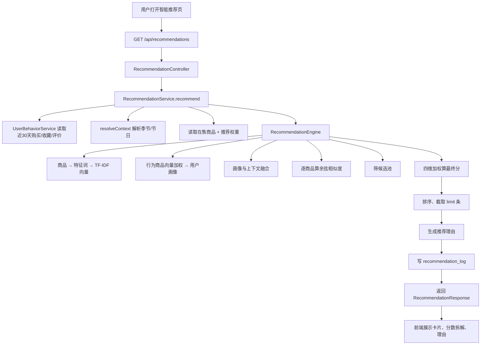

# 推荐算法小白详解（花屿花店项目）

> 这份文档默认你没学过推荐系统、TF-IDF、向量、余弦相似度。  
> 目标：从“用户点开智能推荐页”开始，到“页面为什么显示这几束花”为止，完整走一遍，并用一个 4 束花的例子把每一步算出来。

---

## 0. 先记住三句话

1. **商品变成一串数字**：把每束花的品类、价格带、季节、场景、节日、花语变成“特征词”，再用 TF-IDF 转成向量。
2. **用户行为也变成一串数字**：把用户买过、收藏过、评价过的商品向量按权重加起来，得到“用户口味向量”。
3. **排序不是只看像不像**：最后用四个因素算总分：

```text
最终分 = 0.40 × 内容相似度
       + 0.20 × 热度
       + 0.25 × 节日季节契合度
       + 0.15 × 评分
```

所以：**内容最像的商品，不一定排第一**。

---

## 1. 用花店老板的话理解

假设你是花店老板，来了个顾客小王。

你不知道他喜欢什么，但你知道：

- 他上周买过一束「红玫瑰」；
- 他收藏过一束「百合」；
- 他给一束「粉玫瑰」打了 5 分；
- 今天是母亲节，天气是夏天。

你不会只按“他买过红玫瑰”就一直推红玫瑰，因为：

- 母亲节可能更适合康乃馨、百合；
- 夏天要推应季花；
- 热销、评分高的花更稳；
- 新用户没历史，只能靠节日、季节和热度。

系统做的事，就是把上面这些“人脑判断”变成可以计算的数字。

---

## 2. 一次推荐请求的完整流程



### 请求示例

```http
GET /api/recommendations?limit=10&festival=母亲节&season=SUMMER&scene=home
```

| 参数 | 作用 |
| --- | --- |
| `limit` | 返回几条，默认 10，最大 50 |
| `festival` | 手动指定节日；不传则后端按日期自动识别 |
| `season` | 手动指定季节；不传则按当前月份自动判断 |
| `scene` | 场景标记，例如 `home`、`product`，主要写入上下文与日志 |

---

## 3. 算法用到的四类数据

| 数据 | 来自哪里 | 用来干什么 |
| --- | --- | --- |
| 商品信息 | `product` 表 | 生成商品向量 |
| 用户行为 | `shop_order`、`order_item`、`user_favorite`、`review` | 生成用户画像 |
| 当前上下文 | 当前日期 / URL 参数 | 生成节日、季节偏好 |
| 权重配置 | `recommendation_weight` 表 | 控制四个评分因素各占多少 |

### 3.1 用户行为怎么取

`UserBehaviorService.load(userId)` 取：

- 近 30 天订单；
- 订单状态只算 `PAID`、`FULFILLING`、`COMPLETED`、`AFTER_SALE`；
- 订单明细里的 `productId + quantity`；
- 当前用户的全部收藏；
- 当前用户的可见评价（`VISIBLE`）。

未登录用户没有 `userId`，直接返回空行为 → 冷启动。

### 3.2 节日季节怎么取

`RecommendationService.resolveContext()`：

- 季节：按当前月份自动判断，3–5 月春季、6–8 月夏季、9–11 月秋季、12/1/2 月冬季；URL 传了合法 `season` 就覆盖；
- 节日：URL 传了 `festival` 就直接用；否则调用 `FestivalCalendar.detect(LocalDate.now())` 按日历规则识别。

自动识别支持固定日期节日、母亲节/父亲节/感恩节这类“第几个星期几”、春节区间、毕业季区间。农历节日不做真实农历换算，可手动传参覆盖。

---

## 4. 第一步：把商品变成向量（内容侧）

### 4.1 什么叫“特征词”

系统不是把图片塞进模型，而是给每束花贴一组文字标签，例如：

```text
cat:玫瑰
price:高端
season:SUMMER
occ:表白
fest:情人节
mean:热烈爱情
mean:至死不渝
mean:热烈
mean:烈爱
```

每个词就是向量里的一个“维度”。

### 4.2 项目里实际用了哪些词

`RecommendationEngine.buildTermCounts()` 会把商品拆成 6 类词：

| 词类型 | 来源 | 单词初始权重 |
| --- | --- | --- |
| `cat:` 品类 | `product.category` | 3 |
| `price:` 价格带 | 平价 / 中端 / 高端 | 1 |
| `season:` 季节 | 春/夏/秋/冬；`ALL` 展开成四季 | 1 |
| `occ:` 场景标签 | `occasion_tags` | 2 |
| `fest:` 节日标签 | `festival_tags` | 2 |
| `mean:` 花语 | 按标点切短句，再切二元组 | 1 |

> 价格带阈值现在可以在「指标配置」里改。默认 `<100` 平价、`100–299.99` 中端、`≥300` 高端；它会同时影响商品标签和推荐的价格特征。

花语没有引入中文分词框架，而是用：

```text
"热烈爱情，至死不渝"
→ 整段词：mean:热烈爱情、mean:至死不渝
→ 二元组：mean:热烈、mean:烈爱、mean:爱情 ...
```

这样既轻量又可解释。

### 4.3 词表不是固定的

真实项目不会写死“6 个词”。它每次推荐时遍历所有候选商品，把出现过的词去重，组成当前词表。

以当前演示库的 15 件在售商品计算，词表大约 **144 维**：

| 类型 | 演示数据中的数量 |
| --- | --- |
| `cat:` 品类 | 10 |
| `price:` 价格带 | 3 |
| `season:` 季节 | 4 |
| `occ:` 场景词 | 16 |
| `fest:` 节日词 | 7 |
| `mean:` 花语整词 + 二元组 | 104 |

注意：管理员在「标签管理」里配置的 39 个场景、20 个节日、46 个花语是**商品可选词库**，不是每次推荐必然全部进入词表。只有某个商品真正使用了某个标签，它才会成为词表的一维；商品数据变化，维度自动跟着变。

单件商品只点亮其中约 13–19 个词，所以用 `Map<String, Double>` 稀疏存储，不存一大串 0。

### 4.4 TF-IDF 是什么（小白版）

一个商品里出现某个词，不能直接记 1，因为：

- 出现次数多的词更重要；
- 所有商品都有的词不稀奇，应该降权；
- 只有少数商品有的词更能区分商品。

代码公式：

```text
TF  = 1 + ln(词在该商品里的次数权重)
IDF = ln((文档总数 + 1) / (包含该词的文档数 + 1)) + 1
商品向量某维 = TF × IDF
```

然后把整条向量做 L2 归一化：

```text
每个数 ÷ sqrt(所有数的平方和)
```

归一化后向量长度为 1，后面算余弦相似度时只需要“对应维度相乘再相加”。

### 4.5 一个具体商品的向量（教学简化）

假设词表只有 6 维：

```text
[玫瑰, 百合, 康乃馨, 表白, 生日, 母亲节]
```

红玫瑰 A 的特征是「玫瑰 + 表白」：

```text
原始向量 = [1, 0, 0, 1, 0, 0]
归一化后 = [0.71, 0, 0, 0.71, 0, 0]
```

因为 `sqrt(1²+1²)=1.414`，`1/1.414≈0.71`。

---

## 5. 第二步：把用户行为变成画像（行为侧）

### 5.1 核心思想

> 用户画像不是用户填的“性别、年龄”，而是把用户交互过的商品向量加权求和，得到“口味中心”。

也就是说，用户画像和商品向量在**同一个词表空间**里，后面才能比较。

### 5.2 行为权重

`buildBehaviorVector()` 的规则：

| 行为 | 权重 |
| --- | --- |
| 购买 | `2.0 × min(max(购买数量,1),5)` |
| 收藏 | `1.5` |
| 评价 | `1.2 × clamp(评分,1,5)/5` |
| 购买品类分布 | 给 `cat:品类` 加 `4.0 × 品类占比` |
| 收藏标签 | 给对应 `cat:/occ:/fest:` 词各加 `1.5` |

解释：

- 付钱是最强信号，所以购买权重最高；
- 收藏是明确意向；
- 评价要看评分，5 分才接近 1.2，1 分只有 0.24；
- 品类分布让画像更稳定，不会因为一次偶然收藏就完全跑偏；
- 数量最多按 5 算，避免一次买 100 束把画像彻底带歪。

最后再归一化，得到**行为画像**。

### 5.3 当前上下文也要变成向量

`buildContextVector()`：

- 当前季节 → `season:SUMMER`；
- 当前节日 → `fest:母亲节`，节日权重乘 1.5；
- 用 IDF 值作为初始权重；
- 归一化。

### 5.4 行为画像和上下文怎么融合

代码不会二选一，而是用置信度混合：

```text
frequency = clamp(近30天订单数 / 10, 0, 1)
rating    = 平均评分 / 5；没评分按 0.5
confidence = clamp(0.55 + 0.20 × frequency + 0.15 × rating, 0.55, 0.90)

最终画像 = normalize(
    confidence × 行为画像
  + (1 - confidence) × 上下文画像
)
```

含义：

- 行为越多、评分越完整，越相信用户历史；
- 行为少，也不是完全不信历史，最低置信度 0.55；
- 上限 0.90，永远留一点位置给当前节日/季节。

### 5.5 新用户怎么办

`behavior == null || behavior.isEmpty()` 时：

```text
coldStart = true
最终画像 = 上下文画像
```

也就是：没历史，就把用户当成“当前场景下的访客”。

第一单/第一次收藏/第一条评价出现后，行为不再为空，自动切回“行为 + 上下文”融合模式。

---

## 6. 第三步：算内容相似度

### 6.1 余弦相似度是什么

两个向量都已经归一化，所以：

```text
sim = U₁×P₁ + U₂×P₂ + ... + Un×Pn
```

直观理解：

- 1：方向完全一致；
- 0：没有共同特征；
- 越接近 1：用户口味和商品越像。

`cosine()` 还会把结果裁剪到 `[0,1]`。

### 6.2 候选池

不是所有商品都进入精算：

1. 按内容相似度从高到低排序；
2. 只取 `sim > 0` 的商品；
3. 最多取 `max(candidateLimit, resultLimit)` 个，默认 `candidateLimit=60`；
4. 如果不够，再按销量补足，避免页面空一半。

---

## 7. 第四步：四维加权，算最终分

### 7.1 内容分

就是上一步的 `sim`。

### 7.2 热度分

```text
popularity = ln(1 + 商品销量) / ln(1 + 全店最高销量)
```

用对数是为了不让一个爆款把其他商品压到 0。

### 7.3 节日季节契合分

```text
festivalSeason = 0.65 × 节日匹配 + 0.35 × 季节匹配
```

| 子项 | 规则 |
| --- | --- |
| 节日匹配 | 命中 1.0，不命中 0.2；当前没节日按 0.5 |
| 季节匹配 | 同季节或 `ALL` 1.0；相邻季节 0.6；其他 0.3；缺失 0.5 |

### 7.4 评分分

```text
rating = 平均评分 / 5
```

没有评价时按 0.5，避免新商品被直接判死刑。

### 7.5 最终分

默认权重来自 `RecommendationWeights.DEFAULT`：

```text
content   0.40
popularity 0.20
festival   0.25
rating     0.15
```

管理员可以在「推荐运营」里改四个权重，后端会校验总和为 1；代码还会再 `normalized()` 一次，防止配置异常。

```text
finalScore = 0.40 × content
           + 0.20 × popularity
           + 0.25 × festivalSeason
           + 0.15 × rating
```

最后按 `finalScore` 降序，销量、商品 ID 作为并列时的兜底排序，再截取 `limit` 条。

---

## 8. 全流程手算示例（最重要）

> 这是**教学简化算例**：4 束花、6 个特征词、忽略真实 IDF 的细节，方便你看懂流程。  
> 真实项目做的是动态词表 + TF-IDF + 归一化，但“商品向量 → 用户画像 → 相似度 → 四维排序”的结构完全一样。

### 8.1 设定 4 束花

词表：

```text
[玫瑰, 百合, 康乃馨, 表白, 生日, 母亲节]
```

| 商品 | 特征 | 归一化向量 |
| --- | --- | --- |
| A 红玫瑰 | 玫瑰、表白 | `[0.71, 0, 0, 0.71, 0, 0]` |
| B 粉玫瑰 | 玫瑰、生日 | `[0.71, 0, 0, 0, 0.71, 0]` |
| C 百合 | 百合、母亲节 | `[0, 0.71, 0, 0, 0, 0.71]` |
| D 康乃馨 | 康乃馨、母亲节 | `[0, 0, 0.71, 0, 0, 0.71]` |

### 8.2 小王的行为

| 行为 | 商品 | 权重 |
| --- | --- | --- |
| 买过 1 束 | A 红玫瑰 | `2.0 × 1 = 2.0` |
| 收藏 | C 百合 | `1.5` |
| 评价 5 分 | B 粉玫瑰 | `1.2 × 5/5 = 1.2` |

按维度累加：

```text
玫瑰   = 2.0×0.71 + 1.2×0.71 = 2.272
百合   = 1.5×0.71            = 1.065
康乃馨 = 0
表白   = 2.0×0.71            = 1.420
生日   = 1.2×0.71            = 0.852
母亲节 = 1.5×0.71            = 1.065
```

原始行为画像：

```text
[2.272, 1.065, 0, 1.420, 0.852, 1.065]
```

归一化后：

```text
行为画像 ≈ [0.712, 0.334, 0, 0.445, 0.267, 0.334]
```

读法：小王最偏「玫瑰、表白」，其次「百合、母亲节」，「生日」较弱。

### 8.3 当前上下文

今天是母亲节、夏季。简化成只点亮母亲节：

```text
上下文 = [0, 0, 0, 0, 0, 1]
```

小王近 30 天 1 单、平均评分 5：

```text
frequency = 1 / 10 = 0.1
rating    = 5 / 5 = 1.0
confidence = 0.55 + 0.20×0.1 + 0.15×1.0 = 0.72
```

融合：

```text
0.72 × 行为画像 + 0.28 × 上下文
= [0.513, 0.240, 0, 0.320, 0.192, 0.520]
```

归一化得到最终画像：

```text
U ≈ [0.600, 0.281, 0, 0.375, 0.225, 0.609]
```

可以看到「母亲节」从 0.334 被拉高到 0.609，这就是当前场景的作用。

### 8.4 算内容相似度

| 商品 | 计算 | sim |
| --- | --- | --- |
| A 红玫瑰 | `0.600×0.71 + 0.375×0.71` | **0.692** |
| B 粉玫瑰 | `0.600×0.71 + 0.225×0.71` | **0.586** |
| C 百合 | `0.281×0.71 + 0.609×0.71` | **0.632** |
| D 康乃馨 | `0.609×0.71` | **0.432** |

内容最像的是 A，但还没到最终排名。

### 8.5 另外三项分数（示例数据）

| 商品 | 热度 | 节日季节 | 评分 |
| --- | --- | --- | --- |
| A 红玫瑰 | 0.904 | 0.340 | 0.960 |
| B 粉玫瑰 | 0.851 | 0.340 | 0.920 |
| C 百合 | 0.775 | 1.000 | 0.940 |
| D 康乃馨 | 1.000 | 1.000 | 0.900 |

A、B 没命中母亲节，又是春季花，所以节日季节分低；C、D 命中母亲节，拿满分。

### 8.6 四维加权

| 商品 | 内容×0.4 | 热度×0.2 | 节日×0.25 | 评分×0.15 | 最终分 |
| --- | --- | --- | --- | --- | --- |
| A 红玫瑰 | 0.277 | 0.181 | 0.085 | 0.144 | **0.687** |
| B 粉玫瑰 | 0.234 | 0.170 | 0.085 | 0.138 | **0.627** |
| C 百合 | 0.253 | 0.155 | 0.250 | 0.141 | **0.799** |
| D 康乃馨 | 0.173 | 0.200 | 0.250 | 0.135 | **0.758** |

最终排序：

```text
C 百合 0.799
> D 康乃馨 0.758
> A 红玫瑰 0.687
> B 粉玫瑰 0.627
```

结论：

- A 内容最像，但节日不搭，被 0.25 的场景权重拉下来；
- C 同时有「收藏过百合 + 母亲节 + 评分不错」，排第一；
- D 内容相似度最低，但热度最高、节日满分，排第二。

这就是“多目标排序”，不是“谁最像就推谁”。

---

## 9. 新用户例子

小张没买过、没收藏、没评价，母亲节、夏季访问。

```text
coldStart = true
最终画像 U = [0, 0, 0, 0, 0, 1]
```

| 商品 | sim |
| --- | --- |
| A 红玫瑰 | 0 |
| B 粉玫瑰 | 0 |
| C 百合 | 0.710 |
| D 康乃馨 | 0.710 |

用同样的热度、节日、评分算：

| 商品 | 最终分 |
| --- | --- |
| A 红玫瑰 | 0.410 |
| B 粉玫瑰 | 0.393 |
| C 百合 | 0.830 |
| D 康乃馨 | **0.869** |

排序：`D 康乃馨 > C 百合 > A > B`。

理由文案会变成：

> “新用户冷启动：结合母亲节与夏季时令推荐；热销商品，已售 200 件。”

如果 C、D 只有 2 件，但要 10 条，系统会按销量把 A、B 补进候选池，避免页面空。

---

## 10. 从接口到数据库，再回到页面

```text
前端 recommendations-page.tsx
→ GET /api/recommendations
→ RecommendationController
→ RecommendationService
   ├─ UserBehaviorService 查订单/明细/收藏/评价
   ├─ productMapper 查在售商品
   ├─ recommendation_weight 查四维权重
   └─ RecommendationEngine 计算
→ RecommendationItemVO 列表
→ 前端展示卡片、总分、四项拆解、推荐理由
→ RecommendationService 写 recommendation_log
```

返回里常见字段：

| 字段 | 含义 |
| --- | --- |
| `coldStart` | 是否冷启动 |
| `strategy` | 策略标识 `CONTENT_TFIDF_MULTI_FACTOR` |
| `season` / `festival` | 实际使用的上下文 |
| `weights` | 实际使用的四维权重 |
| `items[].score` | 最终分 |
| `items[].contentScore` | 内容相似度 |
| `items[].popularityScore` | 热度分 |
| `items[].festivalScore` | 节日季节分 |
| `items[].ratingScore` | 评分分 |
| `items[].reason` | 推荐理由 |
| `items[].matchedTags` | 命中的可解释标签 |

推荐理由不是大模型生成的，而是根据 `coldStart`、命中的标签、销量、评分拼出来的，所以**每条都能解释**。

---

## 11. 怎么判断推荐做得好不好

后台「推荐运营」用 5 个模拟人设做离线评估：

| 人设 | 相关规则举例 |
| --- | --- |
| 玫瑰偏好用户 | 品类包含“玫瑰” |
| 节日送礼用户 | 康乃馨/百合或节日标签 |
| 预算敏感用户 | 价格较低 |
| 夏季时令用户 | 夏季或四季通用 |
| 高分口碑用户 | 评分较高 |

常用指标：

| 指标 | 公式 | 含义 |
| --- | --- | --- |
| HitRate | Top-N 至少命中 1 个记 1，否则 0 | 有没有推中 |
| Precision@10 | 命中相关商品数 ÷ 实际返回条数 | 推得准不准 |
| 单人覆盖率 | 该人设返回的不同商品数 ÷ 在售商品数 | 一个人覆盖多广 |
| 整体覆盖率 | 5 个人设推荐并集 ÷ 在售商品数 | 系统有没有只推爆款 |
| 统计覆盖率 | 近 30 天日志出现过的不同商品数 ÷ 在售商品数 | 线上实际覆盖度 |

注意：**“推荐商品”是返回列表，“相关商品”只是评估时按单条规则判断的子集**。一个商品被推荐，不代表它一定通过评估规则，因为引擎是四维加权，不是单规则硬过滤。

---

## 12. 最容易混淆的 8 个问题

### Q1：用户画像和商品向量是相加得到 sim 吗？

不是。画像是“用户口味坐标”，商品向量是“商品坐标”，`sim` 是两个坐标的**余弦夹角**。

### Q2：为什么商品向量出现两次？

第一次作为用户历史行为的“原料”，第二次作为候选商品的“比较对象”。

### Q3：为什么内容最像没排第一？

因为内容只占 0.40，节日季节占 0.25，热度和评分合计 0.35。

### Q4：项目用的是协同过滤吗？

不是。项目是**基于内容的推荐 + 行为加权 + 多因素排序**，没有“和用户相似的其他用户”这一步。

### Q5：为什么不用深度学习 / Embedding？

毕业设计数据量小，动态 TF-IDF 更轻、可解释、无需训练语料；后续可以把商品向量替换成 embedding，排序层不用大改。

### Q6：新用户为什么不直接显示热销榜？

冷启动仍会优先选与当前节日/季节相似的商品，再叠加热度、评分；纯热销榜不会区分母亲节和日常。

### Q7：买过的商品还会再推荐吗？

当前实现**没有排除已购商品**，鲜花有复购属性，可以接受。若业务要求，可在候选池阶段过滤或降权。

### Q8：管理员改标签、价格带会影响推荐吗？

要分两种情况：

- **修改某个商品实际使用的场景 / 节日 / 花语标签**：会影响，因为 `occ:/fest:/mean:` 词来自商品本身；
- **只是在「标签管理」里新增一个标签、但还没有商品使用它**：暂时不影响词表，因为词表是遍历商品动态生成的；
- **修改价格带指标**：会影响 `price:` 特征，且保存指标后会清理商品详情与热销缓存，下一次推荐按新阈值计算。

---

## 13. 代码位置索引

| 作用 | 文件 |
| --- | --- |
| 推荐接口 | `backend/src/main/java/com/flower/mall/module/recommendation/controller/RecommendationController.java` |
| 流程编排、上下文、评估、日志 | `backend/src/main/java/com/flower/mall/module/recommendation/service/RecommendationService.java` |
| 行为数据加载 | `backend/src/main/java/com/flower/mall/module/recommendation/service/UserBehaviorService.java` |
| 核心算法 | `backend/src/main/java/com/flower/mall/module/recommendation/service/RecommendationEngine.java` |
| 商品候选模型 | `backend/src/main/java/com/flower/mall/module/recommendation/model/RecommendationCandidate.java` |
| 四维权重默认值 | `backend/src/main/java/com/flower/mall/module/recommendation/model/RecommendationWeights.java` |
| 节日自动识别 | `backend/src/main/java/com/flower/mall/common/util/FestivalCalendar.java` |
| 价格带指标 | `backend/src/main/java/com/flower/mall/module/metric/service/MetricConfigService.java` |
| 标签管理 | `backend/src/main/java/com/flower/mall/module/tag/service/TagService.java` |
| 推荐页前端 | `frontend/src/pages/recommendations-page.tsx` |
| 推荐运营页 | `frontend/src/pages/admin/admin-recommendations-page.tsx` |
| 指标配置页 | `frontend/src/pages/admin/admin-metrics-page.tsx` |

---

## 14. 当前实现的边界与可优化点

| 边界 | 说明 | 可优化方向 |
| --- | --- | --- |
| 动态词表每次重算 | 数据量大时浪费 | 离线缓存商品向量与 IDF |
| 全量算相似度 | 当前先筛候选池，但相似度仍遍历所有在售商品 | 倒排索引 / 向量索引 |
| 无协同过滤 | 不利用“相似用户” | 引入 User-CF / Item-CF |
| 冷启动个性化弱 | 只靠节日季节与热度 | 注册时选偏好、引入点击/加购 |
| 农历节日近似 | 春节用日期区间，七夕按固定日期 | 接入农历库 |
| 单规则评估 | 相关商品只看季节/价格等单一规则 | 多标签相关性标注 |
| 不排除已购 | 鲜花可复购，但可能重复感强 | 已购降权或短期过滤 |

这些不是“bug”，而是毕业设计规模下主动做的取舍：**轻量、可解释、可评估、可调权重**。

---

## 15. 答辩 30 秒口述模板

> “项目用的是基于内容的混合推荐。先把商品的品类、价格带、季节、场景、节日和花语切成特征词，用 TF-IDF 生成稀疏向量；再把用户近 30 天的购买、收藏、评价对应的商品向量按行为权重累加成用户画像，并按置信度与当前节日季节上下文融合。然后用画像和候选商品算余弦相似度，先取相似度大于 0 的候选池，再对内容、热度、节日季节、评分四项按 0.4、0.2、0.25、0.15 加权排序。新用户没有行为时直接用节日季节上下文冷启动，推荐理由和四项分数都会返回给前端，方便解释和运营调权重。”

---

## 16. 一句话总结

> **商品是坐标，用户画像是“用户碰过的商品坐标的加权中心”，sim 是画像与候选商品的夹角；最终推荐不是只看夹角，而是把内容、热度、节日季节、评分一起算总分。**
